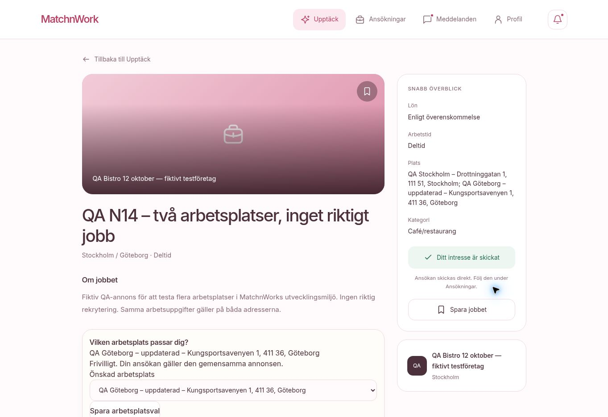

# N14: verifiering i driftsatt dev

Datum: 15 oktober 2026. Leverans PR #59, merge `ba847e5`.
Miljö: youth-job-mvp-dev.vercel.app / MatchnWork DevStaging.
Alla ändringar gäller tydligt fiktiva QA-konton och en märkt QA-annons.

## Genomfört i webbgränssnittet

1. Loggade in med QA-företaget via säker autentiseringsruta.
2. Skapade utkastet ”QA N14 – två arbetsplatser, inget riktigt jobb”.
3. Lade till två namngivna arbetsplatser i Stockholm och Göteborg.
4. Sparade, laddade om och återupptog samma utkast. Båda adresserna och steg 3 fanns kvar.
5. Förhandsvisningen visade båda orterna och fullständiga adresser.
6. Publicerade. Översikten innehöll en ny annons med samma två orter.
7. Öppnade Redigera arbetsplatser, ändrade den andra arbetsplatsens namn och sparade.
8. Den publika annonsvyn visade ändringen på samma annons-ID.
9. Bytte via säker inloggning till det fiktiva ungdomskontot Alex Testsson.
10. Valde Göteborg i upptäcktsfiltret. Resultatet var exakt en QA-annons trots att Göteborg var den andra arbetsplatsen.
11. Kartans reservlista visade en gemensam annons med båda orterna.
12. Skickade ansökan utan att behöva välja arbetsplats först. Status blev ”Ditt intresse är skickat”.
13. Valde Göteborg frivilligt efter ansökan, sparade och laddade om. Valet och skickad ansökan fanns kvar.
14. Databaskontroll bekräftade två distinkta geokodade positioner, sparad adressögonblicksbild och exakt en ansökan för QA-ungdomen.

QA-annons: `dc07a848-5528-4d8f-b5f0-e41fe8679c63`. Den är kvar i dev för fortsatt kartverifiering. Inga riktiga rekryteringar eller betalningar har använts.

## Automatiska kontroller

- `test:job-workplaces`: validering, geokodning, create/update, främmande ägare, äldre adresser och ortsfilter.
- `test:matching` och `test:application-supplement`: godkända regressioner.
- TypeScript och fullständigt webpack-produktionsbygge: godkända.
- Riktad ESLint: inga fel; två befintliga img-varningar.
- `scripts/test-job-workplaces-rls.sql` i staging: ägarredigering, inputvalidering, serverskapad adressögonblicksbild, kandidatens skrivning, företagets läsning utan ändring, bevarad borttagen arbetsplats och nekad utomstående/anonym. Testtransaktionen rullades tillbaka.
- Båda Vercel-byggena för PR och merge är godkända.

## Begränsningar

Testwebbläsaren saknar WebGL. De två faktiska kartnålarna, zoom och klick i en fungerande grafisk karta har därför inte verifierats. Kartans lista och geokodade positioner är kontrollerade; det motsvarar inte ett fullständigt karttest. N14 står kvar För granskning av det skälet.

Företagets visning av arbetsplatsval är RLS-testad i databasen; UI-testet omfattade företagets skapande/redigering och ungdomens ansökan/val. Ingen separat fysisk mobilkontroll har genomförts.

Produktionsdatabasen och tidigare videomigrationshistorik är orörda. N15 har inte påbörjats i denna leverans.

